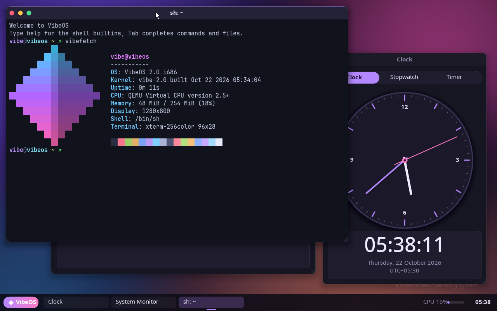
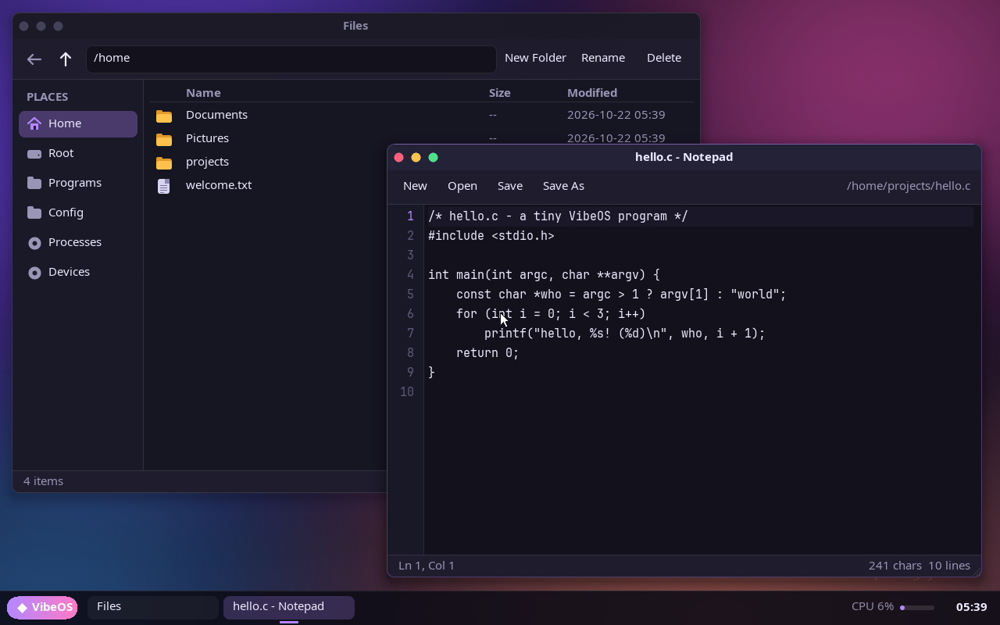
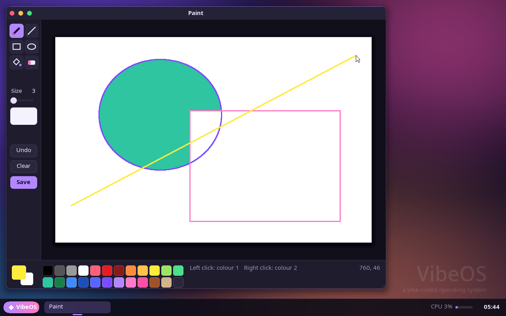
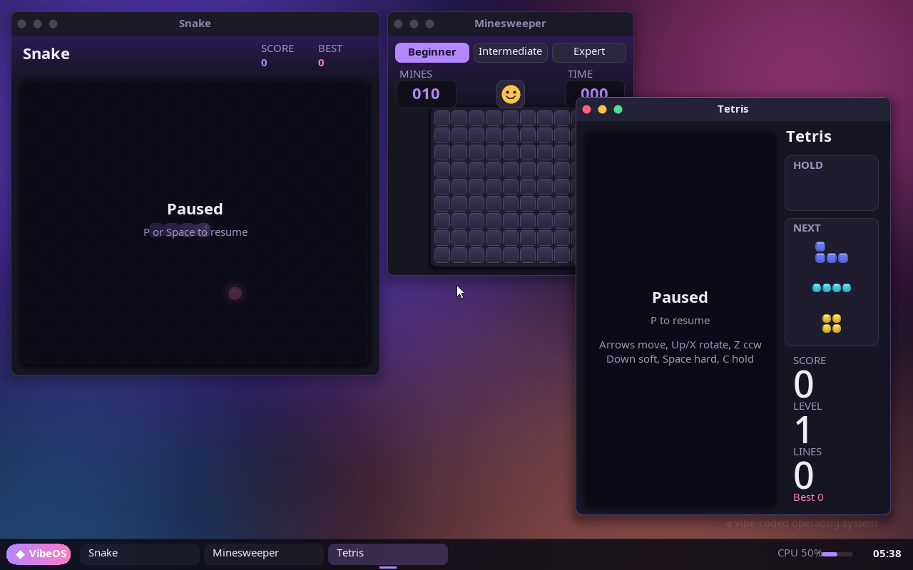
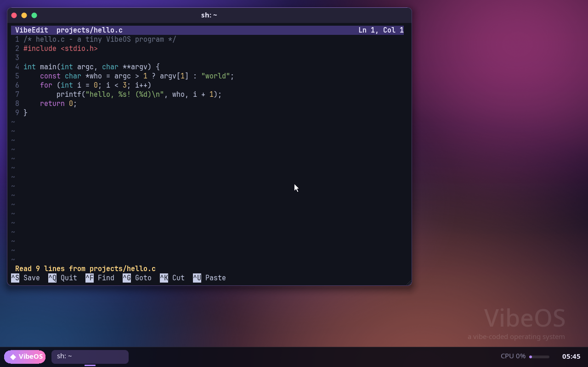

# VibeOS

A vibe-coded operating system for 32-bit x86, written from scratch: its own bootloader,
kernel, compositing window manager, ext2 driver, TCP/IP stack, libc, shell, terminal
emulator, and a set of desktop apps and games.



| | |
|---|---|
|  |  |
|  |  |

## Features

**Kernel**
- Two-stage BIOS bootloader: A20, E820 memory map, VBE 32-bpp linear framebuffer, unreal-mode
  kernel load to 1 MiB. A boot splash with a progress bar crossfades into the desktop.
- Paging with a separate address space per process, physical frame bitmap, kernel heap,
  demand paging (lazy brk, stacks and `mmap`), `mmap`/`munmap`/`mprotect`.
- Preemptive scheduling of user programs, ring 3, ELF loading, `spawn`/`exec`/`waitpid`/signals, threads (`<pthread.h>`: mutexes, condvars),
  per-task FPU state, POSIX-style signal handlers (masks, `sigreturn`, SIGCHLD/SIGWINCH),
  ~50 syscalls (`common/abi.h`).
- VFS with mounts: read/write **ext2** root filesystem on ATA, `/dev` (null zero random tty
  kmsg clipboard notify display dsp), `/proc` (meminfo uptime cpuinfo version processes), pipes, `poll()`.
- TTY line discipline (canonical and raw modes, job control signals, window size).
- **Networking**: PCI, Intel e1000 driver, Ethernet/ARP/IPv4/ICMP/UDP, DHCP, DNS, TLS (BearSSL), and TCP
  (client and server), exposed as BSD-style socket fds.
- PS/2 keyboard and mouse with wheel, plus the VMware/QEMU absolute pointer; CMOS clock;
  PC speaker; **AC'97 sound** (`/dev/dsp`, 48 kHz stereo, software-mixed: any number of programs can play at once).

**Desktop**
- In-kernel compositor with damage tracking, soft shadows, rounded anti-aliased windows,
  window open animations, a procedural aurora wallpaper (5 themes).
- Drag, resize, maximise (double-click the title bar), minimise, edge snapping and Super+arrow
  tiling, smart window placement, a right-click window menu (always on top, move to workspace),
  Super+drag to move from anywhere, a desktop context menu.
- Runtime resolution switching on the QEMU/Bochs display adapter (1024x768 up to 2560x1600): Settings >
  Display with a "Keep this resolution?" revert, or `display 1920x1080` in the shell; saved in `/etc/display`.
- 4 virtual workspaces (Super+1..4, Super+Shift+1..4 to move a window), an Alt+Tab switcher with
  live thumbnails, toast notifications and a notification center (Super+N; `notify TITLE BODY`,
  `/dev/notify`), a taskbar with launcher, workspace dots, volume and network tray, CPU meter and clock.
- An xterm-compatible terminal emulator (256 colours and truecolor, bold/dim/italic/underline/strike,
  alternate screen, scroll regions, scrollback, UTF-8) with mouse selection; a system clipboard shared by
  every app. Terminal windows have tabs (Ctrl+Shift+T/W, Ctrl+PgUp/PgDn), scrollback search (Ctrl+Shift+F),
  zoom (Ctrl+= / Ctrl+- / Ctrl+0), Ctrl+Shift+C/V and Ctrl+click on a URL to open it in the browser.
- Fonts (JetBrains Mono, Noto Sans) rasterised into the build with Latin-1, arrows, symbols
  and box/block glyphs.
- Apps are ordinary processes: a window is a file descriptor whose buffer is mapped into the
  process, and `read()` returns input events. `libgui` + `ui.h` is a small immediate-mode
  widget toolkit.

**Userland**
- A libc: stdio, printf/scanf (incl. `%a`), a binned malloc, correctly-rounded strtod/libm, POSIX regex (BRE/ERE, `regcomp`/`regexec`), string, math, time, termios, dirents, sockets.
- `/bin/sh`: a scripting shell with if/for/while/case, functions, `$(..)`, `$((..))`,
  here-docs, `test`/`read`/`printf` builtins and `#!` scripts, plus line editing, persistent
  history, Ctrl-R, `!!`, Tab completion, pipes, redirections and globbing.
- Coreutils: `ls cat echo mkdir rm rmdir touch cp mv pwd wc head tail grep hexdump ps kill
  uptime date free clear sleep env seq sort uniq tee find which stat dmesg uname cal fortune
  vibefetch colortest` and more.
- Text processing: `grep` (BRE/ERE/fixed, context, `-o -w -r`), `sed`, `awk`, `tr cut paste nl tac rev`, `diff` (normal and
  unified), `cmp`, `xargs`, `md5sum sha256sum`.
- `/bin/lua`: Lua 5.4 with a REPL, plus `vibe` (system info, processes, beep) and `gui` (windows) modules.
- `/bin/python`: MicroPython 1.29 with a line-editing REPL (history, Tab completion), scripts, file I/O through `open`/`os`, and `sys time math json re random struct collections os.path` plus `vibe`, `gui` (windows and events), `socket`/`select`/`ssl` (TCP/UDP, TLS client) modules; `projects/paint.py` is a launcher app (Python Paint).
- `/bin/tcc`: TinyCC 0.9.27 compiles C inside VibeOS against its own libc (`tcc hello.c -o hello`, `tcc -run`, `-lgui` for windows); see `~/projects/README.txt`.
- Terminal apps: `edit` (a nano-like editor with C syntax highlighting), `less`, `top`.
- Network tools: `ifconfig ping nslookup wget nc` (`nc -l` listens; `wget` does https:// with certificate checks), and `httpd` — run it inside `make run` and open http://localhost:8080 on the host. Audio: `play` (WAV files), `midi` (Standard MIDI Files through an OPL3 FM synth; needs the Freedoom WAD for its instruments), `tone`.
- GUI apps: Files, Notepad, Browser (HTTP and HTTPS, HTML + basic CSS, PNG/JPEG/GIF images, forms, find-in-page), Paint (saves/opens PNG), **Code** (a small IDE: project sidebar, tabs, C and Lua highlighting, find/replace, Build with tcc and Run with an output pane, click an error to jump to it), Image
  viewer (PNG/JPEG/GIF/BMP/PPM, animated GIFs, zoom, pan, browse), Calculator, Clock (with stopwatch and timer), System
  Monitor, Settings, About, Piano (a polyphonic synth keyboard), Music (library, playlist, shuffle/repeat, seek, album art; MP3/Ogg/WAV). PrtSc saves a PNG screenshot
  to `~/Pictures`.
- Games: Snake, Tetris, Minesweeper, **Chess** against an alpha-beta AI, **2048** with animations, **Solitaire** (drag and drop), and **Doom** (doomgeneric + the BSD-licensed Freedoom, with sound effects and OPL3 FM music; `make doom-wad` fetches the game data).

## Building and running

You need `gcc` with 32-bit support, `nasm`, `e2fsprogs` (`mke2fs`), `python3` with Pillow,
and `qemu-system-i386`.

```sh
make            # build build/vibeos.img
make run        # boot it in QEMU (user-mode networking, PC speaker and AC'97 to your sound server)
make clean
```

Try `vibefetch`, `top`, `edit welcome.txt`, `ping 10.0.2.2` or `wget http://example.com/` in the
terminal; press Super for the launcher; right-click the desktop to change the wallpaper, or open Settings.

### Testing

`tools/vmtest.py` boots the image in QEMU and drives it from a script: type text, press keys,
move and click the mouse, wait for serial output, take screenshots. For example:

```sh
python3 tools/vmtest.py smoke 'type:ls -l /bin\n' sleep:1 shot:build/ls.png
```

`/etc/autostart` (in `root/etc/`, not committed) picks what the desktop opens at boot:
`shell`, `term ARGV…` or `run ARGV…`. There are host-side tests for the ext2 driver
(`tools/ext2test`, checked against `e2fsck`), the terminal emulator (`tools/termtest`), libc (`tools/libctest`) and the image codecs against Pillow (`tools/imagetest`) and the chess move generator (`tools/chesstest`, perft; both in `make test-host`).

## Layout

```
boot/        stage1 (MBR) and stage2 bootloader
kernel/      arch (GDT/IDT/ISRs), core (scheduler, processes, syscalls, tty), mm, fs, dev, net, gui
common/      code shared by kernel and userland: ABI, graphics, fonts, terminal emulator
user/lib     libc, libgui, the ui.h toolkit
user/bin     every program in /bin (NAME.c or NAME/*.c)
root/        files copied into the root filesystem
tools/       font baker, QEMU test driver, host-side tests
docs/        architecture notes and screenshots
```

How it fits together is described in [docs/ARCHITECTURE.md](docs/ARCHITECTURE.md), and what
was built when is in [CHANGELOG.md](CHANGELOG.md).

## Disclaimer

VibeOS is a hobby project for fun and learning, not for real-world use. Expect bugs and
wild design choices.
