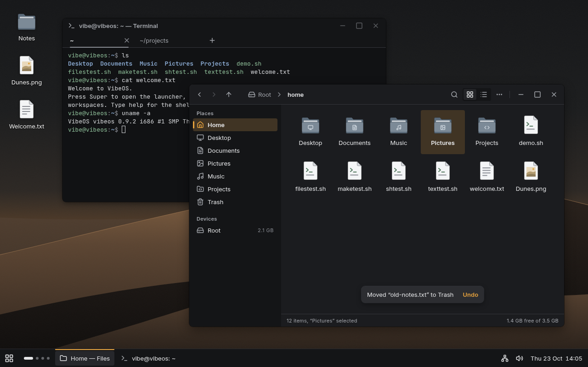
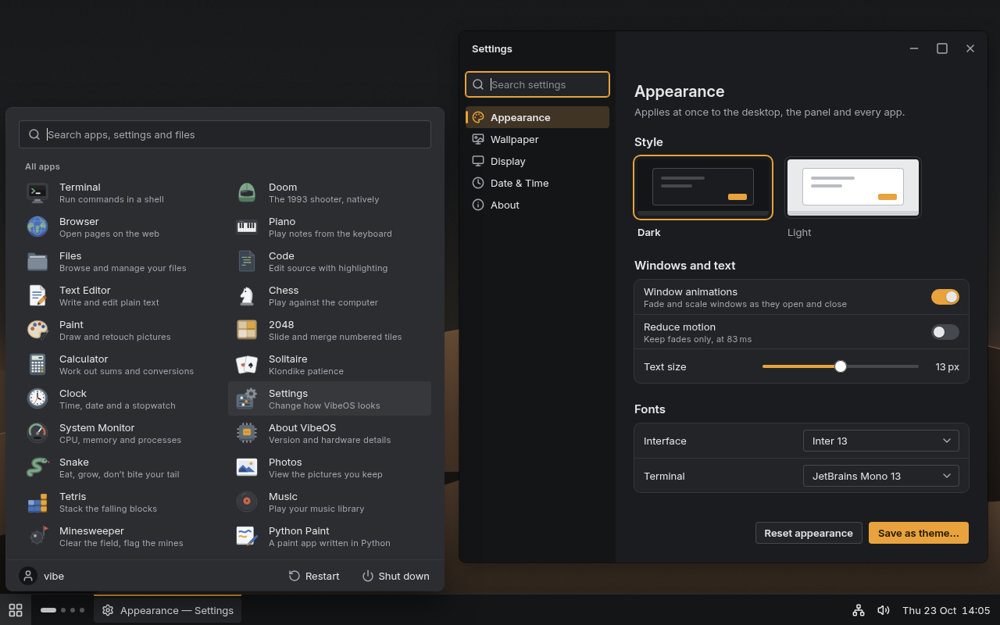

# VibeOS design spec: Graphite & Signal

This is the binding spec for the UI redesign (direction A of `vibeos-design/design-research/BRIEF.md`).
Where it and the mockups disagree, this file wins; §11 lists every place where it departs from them on purpose.

Target pictures (1280×800, 1x), rendered from the generator that holds the exact values:

| Desktop | Launcher + Settings |
|---|---|
|  |  |

Code holds the tokens. Widget, compositor and app code use these names and never literal colours, sizes or durations:

- `common/theme.h` / `theme.c`: colours per theme (`struct theme`, the active one in `cur_theme` in the kernel and `ui_th` in libgui).
- `common/design.h`: spacing, radii, sizes, elevation geometry, focus ring, motion and type roles.
- `common/gfx.h`: the drawing primitives (§10).

## 1. The idea

The UI is a quiet graphite workstation with no tint and no blue. Everything is greyscale except one sodium-amber
signal (#E8A33D). Amber only ever means *this is where you are*: the focused window's panel button, the selected row,
the active tab, the on-state, the primary action and keyboard focus. The **signal line** is the one signature move. It is
a 2px amber mark on the active panel button (top edge), under the active tab, and as a 3×16 marker on the selected
sidebar row. Everything else stays quiet: flat surfaces one tone step apart, black shadows that mean z-order, Inter at
five sizes, Lucide icons at 16px.

Do not use gradients, glows, glass, neon, gloss, tinted neutrals, letter-in-square icons, font glyphs as icons,
coloured left stripes, ALL CAPS or taglines. Use sentence case everywhere and left-align by default. Only the clock,
icon labels and empty states are centred.

## 2. Colour

### 2.1 Tokens

There are three built-in themes: `graphite` (dark, the default), `graphite-light` and `contrast` (high contrast,
same structure). The old ids `dark` and `light` still resolve, so existing `/etc/theme` files keep working.
Ratios are WCAG 2.x against `window` / `raised`, computed by `theme_contrast` (tools/themetest checks every pair below).

| Token (`struct theme`) | Graphite (dark) | Graphite light | High contrast | Role |
|---|---|---|---|---|
| `base` | #141517 | #E9EAEC | #000000 | Panel, sidebars, inactive title bars, segmented wells |
| `window` | #1B1C1F | #F4F5F6 | #0A0A0B | Window content, focused title bar |
| `raised` | #232427 | #FFFFFF | #18181A | Cards, list wells, inputs, secondary buttons, the focused panel button |
| `overlay` | #2C2D31 | #FFFFFF | #1E1E21 | Menus, popovers, dialogs, tooltips, toasts, launcher |
| `line` | #34363B · 1.4/1.3 | #D6D8DB · 1.3/1.4 | #8C8C90 · 5.9/5.3 | 1px separators, overlay outlines, card rings (decorative, not 3:1) |
| `line_strong` | #45484E · 1.9/1.7 | #B9BCC1 · 1.7/1.9 | #D0D0D4 | Secondary button outline, slider thumb ring |
| `control` | #74777E · 3.8/3.5 | #82858C · 3.4/3.7 | #FFFFFF | **3:1** edges: input, checkbox and radio outlines, switch-off track, slider track |
| `text` | #E6E7E9 · 13.8/12.5 | #1B1C1F · 15.6/17.0 | #FFFFFF | Primary text, active icons |
| `text2` | #A4A7AD · 7.1/6.4 | #55585E · 6.5/7.1 | #E4E4E6 | Secondary text, idle icons (≥4.5 on every surface, selection included) |
| `text3` | #8A8D94 · 5.1/4.7 | #66696F · 5.0/5.5 | #C8C8CC | Placeholders, captions, shortcut hints. ≥4.5 on base/window/raised only: on a dark `overlay` use `text2` |
| `disabled` | `text` @38% | `text` @38% | `text` @45% | Disabled text and icons (exempt from contrast) |
| `accent` | #E8A33D · 7.9/7.2 | #E8A33D · 2.0/2.1 | #FFC24D | Fills: primary button, switch on, slider fill, checkbox on, progress |
| `accent_hover` / `accent_press` | #F0B358 / #D18F2B | #F0B358 / #D18F2B | #FFD27A / #E6A82E | Accent fill states |
| `on_accent` | #1A1300 (8.6:1 on accent) | #1A1300 | #000000 | Text and icons on accent fills |
| `accent_text` | #E8A33D · 7.9/7.2 | #965509 · 5.3/5.8 | #FFC24D | Accent as text: links, the toast action, **the focus ring**, selected-row icons |
| `accent_line` | #E8A33D | #AC792D · 3.5/3.8 | #FFC24D | The signal line; on light, the 1px inset rim on accent fills that carry no text (§2.3) |
| `selection` | #403424 | #F1E3CD | #553C00 | Selected rows/cells, text selection, current-line tint |
| `hover_ov` / `press_ov` | `text` @6% / @12% | `text` @6% / @12% | white @12% / @22% | Translucent backplates for ghost controls and rows, blended over whatever is below |
| `scrim` | #000 @40% | #000 @32% | #000 @65% | Behind modal dialogs |
| `danger` | #F2706A · 5.9/5.4 | #B42C26 · 5.8/6.3 | #FF8A80 | Errors, destructive buttons and menu items |
| `on_danger` | #1A0605 | #FFFFFF | #000000 | Text on a danger fill |
| `warning` | #D8B23E | #7F6200 | #FFD54F | Warnings. Always paired with the triangle icon, because the hue is near the accent |
| `success` | #5BBF7A | #1B6E3B | #7BE495 | Success |
| `info` | #6AA3F0 | #2560C2 | #8AB8FF | Information |
| `thumb` | #E6E7E9 | #FFFFFF (with a 1px `control` ring) | #000000 | Switch and slider thumbs |
| `hilite` | #FFF @6% | none | none | Inner 1px top highlight on dark windows (separates same-tone windows) |
| `ring` | #000 @50% | #000 @12% | #8C8C90 | 1px window outline drawn just outside the frame (`gfx_ring_out`) |
| `elev[1..4]` | 77 / 92 / 102 / 128 | 36 / 41 / 46 / 61 | 128 / 140 / 150 / 170 | Shadow peak alpha (0–255) for E1–E4 (§6) |

All semantic colours reach 4.5:1 as text on `base`, `window`, `raised` and `overlay` in every theme.

### 2.2 Accents

The presets are amber (the default), blue, teal, green, orange, red, pink, violet and graphite, or any RRGGBB value
(`theme accent X`). `theme_set_accent` derives everything else from the one hue:

- On dark themes the fill is nudged until it reaches 3:1 on every surface. On light themes the fill keeps its hue,
  and `accent_line` (the hue darkened to 3:1) provides the edge.
- `on_accent` is #1A1300 ink, or white or black if the ink can't reach 4.5:1. Hover is the fill mixed 16% toward
  white and press is 12% toward black. Each stops early if the ink would drop below 4.5:1.
- `accent_text` is nudged to 4.5:1 on every surface.
- `selection` is the window mixed about 18% toward the accent (20% on light), backed off until `text` and `text2`
  stay at 4.5:1 on it.

### 2.3 Rules

- Elevation in dark mode is lightness: base < window < raised < overlay. A card darker than its ground reads as a hole.
- Accent appears only for state: primary action, current selection, focus, on, progress and the signal line. Use at most
  one large accent fill per window, and never use it for decoration or for an inactive state.
- On light themes an amber fill reaches only 2:1 against white. Accent fills that carry no text (switch on, slider
  fill, checked checkbox, progress) therefore get a 1px inset `accent_line` rim (`gfx_round_rect`). Primary buttons
  carry text, so they need no rim.
- Colour is never the only signal. Add an icon or a word too.
- No pure #000 or #FFF for large dark surfaces or for text, except in the high-contrast theme.
- Hover is `hover_ov` over the control's own fill, and pressed is `press_ov`. Disabled draws at 38% opacity with no hover.

### 2.4 Terminal

The palette is calm ANSI tuned to the graphite surfaces. Every colour reads at ≥4.5:1 on the terminal background
except bright black (≥3:1). The prompt uses the palette, not literal colours: `vibe@vibeos` in 32 (green), `:` in
90, the path in 34 (blue) and `$` in 90 (31 after a failed command).

| | bg | fg | bold | 0 | 1 | 2 | 3 | 4 | 5 | 6 | 7 |
|---|---|---|---|---|---|---|---|---|---|---|---|
| Graphite | #111214 | #D7D9DC | #F0F1F2 | #2C2E33 | #E5736C | #8FBF9A | #D9B45E | #8FB0D9 | #C29BC9 | #7FBFBF | #C5C8CD |
| bright 8–15 | | | | #7C8088 | #F08C86 | #A8D4B1 | #E8C878 | #A9C4E6 | #D4B3DA | #9AD2D1 | #EDEEF0 |
| Light | #FBFBFC | #1B1C1F | #0E0F11 | #1B1C1F | #B42C26 | #1B6E3B | #7F6200 | #2560C2 | #8B3A8F | #0E6E70 | #55585E |
| bright 8–15 | | | | #66696F | #C2362F | #237A45 | #8A6A00 | #2F6BD0 | #9A479E | #13797B | #2B2D31 |

Selection is `selection`. Search matches are #4A3B1E (dark) or #F6E2AE (light), and the current match is an `accent`
fill with `on_accent` text. A hovered link takes colour 4.

## 3. Type

The UI face is **Inter**; the mono face is **JetBrains Mono** (terminal, code, hex and logs only). Both are OFL and live in
`vibeos-design/mockups/fonts/` (`Inter-VF.ttf`, `JetBrainsMono-VF.ttf`, licences alongside). Use five sizes, two
weights and sentence case. Never use light weights, italics in UI, or all caps.

### 3.1 What tools/mkfont.py must bake (for the assets agent)

| Symbol (`font.h`) | Role macro (`design.h`) | Face | Size px | Line px | Weight (wght) | Tracking | Used for |
|---|---|---|---|---|---|---|---|
| `font_caption` | `T_CAPTION` | Inter | 11 | 14 | 400 | +0.5px | Timestamps, sublines, status bars, badges, shortcut hints |
| `font_caption_bold` | `T_CAPTION_B` | Inter | 11 | 14 | 600 | +0.3px | Group labels ("Places", "All apps"), table headers |
| `font_body` | `T_BODY` | Inter | 13 | 18 | 400 | 0 | All control labels, menus, lists, body text |
| `font_body_bold` | `T_BODY_B` | Inter | 13 | 18 | 600 | 0 | Window titles, buttons, selected rows, emphasis |
| `font_heading` | `T_HEADING` | Inter | 15 | 20 | 600 | 0 | Dialog titles, settings group headings |
| `font_title` | `T_TITLE` | Inter | 20 | 26 | 600 | 0 | Page titles inside apps (replaces the Noto Bold 22 cut: same role) |
| `font_display` | `T_DISPLAY` | Inter | 28 | 34 | 600 | 0 | Lock/login clock, the boot wordmark, big empty states. Rare |
| `font_mono` | `T_MONO` | JetBrains Mono | 13 | 18 | 400 | 0 | Code, hex, logs |
| `font_mono_bold` | | JetBrains Mono | 13 | 18 | 700 | 0 | Bold in code/terminal |

Baking notes:

- When the ramp exists, `font.h` must `#define FONT_RAMP 1`. `design.h` then maps the `T_*` roles to the Inter cuts.
  Until then the roles fall back to today's Noto fonts, so code can switch to the role names now.
- Keep `font_ui`, `font_ui_bold` and `font_big` as they are (Noto 15/15 bold/52) until every caller has moved to a `T_*`
  role, then delete them. That way nothing regresses half-ported.
- Tracking: add it to each advance before rounding. The tracking column above matches the mockups' `letter-spacing`.
- Variable axes: set `wght` exactly as listed. If the file has an `opsz` axis, set opsz to the pixel size clamped to the
  axis range, which is what the browser did for the mockups.
- Bake tabular figures (`tnum`) into the digits of at least `font_body` and `font_caption`. The clock, sizes and
  calculator must not jitter.
- Line height is the box height. Store `ascent` so callers centre with `(h - f->height) / 2` with no fudge.
- Terminal sizes (`common/termfonts.c`): the default cell is JetBrains Mono 13/18, with zoom steps 11 / 13 / 15 / 18.

## 4. Spacing, radii and sizes (`design.h`)

- Spacing: `SP_1..SP_9` = 2, 4, 8, 12, 16, 20, 24, 32, 48. Use 4–8 inside a group (icon to label, label to control)
  and 16–24 between groups. The gap above a heading is always larger than the gap below it (20 above, 8 below).
  The window content inset is 16 and the dialog inset 20. Buttons in a row sit 8 apart. Toolbar items sit 4 apart,
  with 12 between groups.
- Radii: `R_0` 0 (maximised/snapped windows, panel), `R_1` 2 (progress ends, text selection, the marker),
  `R_2` 4 (buttons, inputs, checkboxes, row backplates, tooltips, tabs), `R_3` 8 (windows, menus, popovers, dialogs,
  toasts, cards, launcher), `R_F(h)` = h/2 (switches, radios, thumbs, scrollbars, avatars, badges). Nested radii are
  concentric: inner = outer − inset (an 8px menu with 4px padding has 4px item backplates).
- Heights: control `H_CTL` 28 (compact 24), search 32, launcher search 36, rows 28 (two-line 44), title bar 32,
  header bar 44, panel 40, toolbar 40, tabs 32, status bar 28, footer 40.
- Hit targets are at least 24×24 even when the visual is 16. Text never touches an edge: the inset is at least 8.

## 5. Icons

Use Lucide (ISC, with Feather MIT notices shipped) at 16px with a 1.5px stroke (20px: 1.75px). Icons are A8 masks
tinted at draw time with `gfx_mask`: `text2` idle, `text` hover/active, `accent_text` selected/on, a semantic colour
for status, `disabled` when off. Sizes are 16 in menus, lists, buttons, the tray and title bars; 20 for the panel
launcher button; 24 and up only for empty states. App icons are 48 (launcher grid, Files), 32 (launcher list,
notifications) and 16 symbolic in the panel (the Lucide equivalent, never a shrunk colour icon).

## 6. Elevation (`ELEV[]` in design.h, alpha in `theme.elev[]`)

Shadows are black, offset downward and blurred (σ = blur/2). Each (radius, blur) pair is baked once into a 9-slice
corner tile and an edge profile (`gfx_shadow9`, three box passes ≈ Gaussian). A frame then costs one blend per
shadow pixel *outside* the caster: about 0.5 ms for a focused 800×600 window on the host. Shadows never animate.

| Level | `ELEV` dy / blur | Reach | Dark alpha | Light alpha | Plus | Used by |
|---|---|---|---|---|---|---|
| E0 | – | – | – | – | tone step and/or 1px `line` | In-window cards, panel, sidebars |
| E1 | 1 / 2 | 3px | 30% | 14% | – | Switch/slider thumbs, the selected segment |
| E2 | 4 / 12 | 18px | 36% | 16% | 1px `line` outline (overlays) | Menus, popovers, tooltips, toasts, notifications, **inactive windows** |
| E3 | 8 / 24 | 36px | 40% | 18% | 1px `ring` outside, `hilite` top row inside (dark) | The focused window |
| E4 | 16 / 40 | 60px | 50% | 24% | 1px `line` outline | Dialogs, launcher, notification centre |

Inactive windows use E2 geometry with the window `ring`, not the `line` outline. On dark themes the shadow is barely
visible and the outline does the separating. A window draws in this order: `gfx_elev`, then the frame fill,
`gfx_ring_out` (`ring`), and the `hilite` 1px row inset by the radius.

## 7. Focus

Focus is a 2px `accent_text` ring with a 1px gap outside the control, concentric with its radius
(`gfx_focus_ring(x, y, w, h, r)` draws at radius r+3). In lists and menus it is an inset 2px ring on the row
backplate instead (`gfx_rrect_ring(.., t = 2)`). Text inputs turn their outline into the ring: a 1px inset plus 1px
outset `accent_text` ring, 2px total, straddling the edge. The ring shows only for keyboard focus. Set a `focus_visible`
flag on Tab or an arrow key and clear it on a pointer press. It appears at once and fades out over `D_FAST`. It always
reaches 3:1 (themetest checks `accent_text` on every surface). Never use a glow, and never remove the ring.

## 8. Motion (`design.h`)

| Token | ms | Use |
|---|---|---|
| `D_INSTANT` | 0 | Hover colour changes |
| `D_FAST` | 100 | Press feedback, focus ring out, tooltip fade |
| `D_NORMAL` | 150 | Menus/popovers (fade + 4px slide from the anchor), toggles, the tab underline slide, the launcher (fade + 8px rise) |
| `D_SLOW` | 200 | Window open (scale 0.97→1 + fade), minimise/restore |
| `D_WINDOW` | 250 | Maximise/snap geometry |
| `D_EXIT(d)` | 0.7×d | Every exit |
| `D_REDUCED` | 83 | With reduce motion (or window animations off): every duration is 0 except fades, which become 83ms |

Entrances ease out with cubic-bezier(0,0,0,1), exits ease in with (0.4,0,1,1), and point-to-point moves use
(0.33,0,0.67,1). Precompute each curve as a 256-entry LUT. Animate only opacity, translation and integer-snapped
scale. Nothing bounces and nothing loops, except the spinner (0.8s/turn) and the caret (`D_CARET` 530ms blink, which
stops after `D_CARET_IDLE` 10s idle).
Timers: tooltip after `D_TOOLTIP` 600ms (instant for a neighbour within 1.5s), submenus after 200ms, toasts 4s,
notifications 5s (paused while hovered), scrollbars fade out 800ms after the scroll stops.

## 9. Components (px at 1x)

Every interactive control has default, hover, pressed, focus-visible and disabled states, plus selected/checked where
it applies. Containers also have empty, loading and error states. Drawing functions take `(rect, state, theme)`.

**Window frame.** The radius is `R_3`, dropping to 0 when maximised or snapped. Focused windows get E3 plus `ring`
and, on dark, `hilite` on the first content row. Inactive windows get E2 plus `ring`. Light themes have no visible
border because the ring does the job. There is a 6px invisible resize border outside the frame. All empty title space
drags, a double click maximises, and a right click opens the window menu.

**Title bar** (`H_TITLE` 32). The background is `window` when focused and `base` when inactive. Left to right:
a 12px inset, a 16px app symbolic icon in `text2`, an 8px gap, the title in `T_BODY_B` (`text`, or `text2` when
inactive), left-aligned and ellipsised. Then flexible space, then the controls. Titles name the content
("notes.txt — Editor").

**Window controls.** Minimise, maximise and close (Lucide `minus`, `square`, `x`), each with a 32×24 hit area, 4px
apart and 6px from the right edge. The 16px glyph is `text2`. Hover is a `hover_ov` backplate at `R_2`. Close on hover
is a `danger` fill with an `on_danger` glyph. Inactive windows draw the glyphs at 50% alpha. They sit on the right and
there are no traffic lights.

**Header bar** (apps that merge the toolbar into the title, `H_HEADER` 44). The background is `window` with a 1px
`line` bottom rule, an 8px left inset and 12px between groups. It holds 28px ghost buttons (back, forward, up, 4
apart), then the breadcrumbs (28 tall, 8px padding, separators are a 16px `chevron-right` in `text3`, the current
crumb in `T_BODY_B`), then flexible space, then tools, then a 1×16 `line` divider (−4px margins), then the window
controls. The Settings variant splits it: the first 200px are `base` with the app name in `T_BODY_B` at a 16px inset,
and the rest is `window`.

**Panel** (bottom, `H_PANEL` 40; top is also allowed, a side panel never). The background is `base` with a 1px `line`
top edge, and there is no blur and no shadow.
- Launcher button: 40×40, a 20px `layout-grid` icon in `text`, hover `hover_ov`, `press_ov` while the launcher is open.
- Workspaces: 4 pills with a 12px inset and 6px gaps. The current one is 20×6 `text` at `R_F`, the others 6×6
  `text2` at 55%. There are no digits; the tooltip reads "Workspace 1 · Super+1".
- Task buttons: 32 tall at panel y+5, min 120 and max 200 wide, 0 10 padding, `R_2`, 4 apart. Each has a 16px icon,
  an 8px gap and a `T_BODY` label, ellipsised. Icons are `text2`, or `text` when focused. Minimised windows use `text2`
  labels. The focused window's button gets a `raised` fill and **the signal line**: 2px of `accent_line` at panel
  rows y+1..y+2 (just under the top edge), the button's full width.
- Right side: tray icons 16px in 32×32 cells (each with a tooltip), then the clock "Thu 23 Oct  14:05" in `T_BODY`
  with tabular figures, padding 0 12 0 8.
- Panel popovers are E2 at `R_3` on `overlay`, anchored 4px above the panel and aligned to their button.

**Launcher.** 560 wide, content height, anchored 8px from the left and 4px above the panel. It is `overlay` with 16px
padding, `R_3`, E4 and a `line` outline.
- Search: 36 tall, `R_2`, `raised` fill with a 1px `control` inset ring, 0 12 padding, a 16px `search` icon in `text2`
  with an 8px gap, placeholder "Search apps, settings and files" in `text3`. It has focus on open and filters as you
  type. Enter launches the first result, and the arrow keys move through it.
- "All apps": a `T_CAPTION_B` label in `text2`, margins 16 8 4.
- Apps: 2 columns, 8px column gap, rows `H_ROW2` 44 with 0 8 padding, a 12px gap and `R_2`. Each row has a 32px app
  icon, the name in `T_BODY` `text` and the comment in `T_CAPTION` `text2` (e.g. "Browse and manage your files").
  Hover and keyboard selection use `hover_ov`.
- Footer: 40 tall with a 1px `line` top rule, padding 0 8 0 16 (bleeding to the launcher's edges). It has a 24px
  round avatar (`base` fill, 16px `user` in `text2`), an 8px gap and the user name. On the right are ghost buttons
  "Restart" and "Shut down": 28 tall, 0 10 padding, a 16px icon in `text2` with a 6px gap.
- Search results list apps, then settings, then files. Esc or a click outside closes the launcher.

**Menus** (context and app). `overlay`, `R_3`, E2, a 1px `line` outline, 4px padding, 180–320 wide.
- Items are `H_ROW` 28 with 0 12 padding and an `R_2` backplate inset by the 4px padding. Hover and keyboard
  selection use `hover_ov` in every menu.
- The icon column (16 + 8 gap) is shown only if an item in the group has an icon. Checked items show a 16px `check`
  in that column. Submenus show a 16px `chevron-right`.
- Shortcuts are right-aligned in `T_BODY` `text3` (`text2` on dark overlays), in main/app menus only.
- Separators are 1px `line` with 4px vertical margins, full width minus 12px insets.
- Destructive items come last, in `danger`. An item that opens a dialog ends with "…". Unavailable items are hidden in
  context menus and dimmed in app menus.
- Menus flip up or left when there is no room. Submenus overlap the parent by 4px. Esc closes one level.

**Buttons** (`H_CTL` 28, 0 12 padding, `R_2`, `T_BODY_B`, optional 16px icon with a 6px gap, min width 72 in dialogs).
- Primary: `accent` fill and `on_accent` text, hover/press `accent_hover`/`accent_press`. At most one per view.
- Secondary: `raised` fill, 1px inset `line_strong` ring, `text`. Hover/press add `hover_ov`/`press_ov`.
- Ghost: no fill, `text`, with a `hover_ov` backplate on hover. Use them in toolbars, title bars and panels.
  Icon-only ghost buttons are 28×28 with a 16px icon in `text2`.
- Destructive: `danger` fill with `on_danger` text.
- Compact: 24 tall with 0 8 padding, for dense toolbars only.
- Disabled: 38% opacity with no hover. Loading: a 14px spinner replaces the label and the width stays the same.
- Labels are a verb plus an object ("Save as theme…", "Delete 3 files"). Never "OK".

**Dropdown** is a secondary button with a `T_BODY` (400) value, padding 0 8 0 12, and a 16px `chevron-down` in
`text2` on the right. It opens a menu aligned to its left edge.

**Text input** (`H_CTL` 28; search fields 32; launcher search 36). `R_2`, `raised` fill, a 1px inset `control` ring,
padding 0 8, and a 16px leading icon with an 8px gap.
- Placeholder in `text3`, value in `text`. The caret is 1×16 in `text`. Selection is `selection`.
- Hover moves the ring one step toward `text`. Focus turns it into the 2px straddling `accent_text` ring (§7).
- Error: a 1px `danger` ring plus a `T_CAPTION` message in `danger`, 4px below.
- The label sits above the field in `T_BODY` with a 4px gap. The placeholder is never the label.

**Checkbox.** A 16×16 box at `R_2` with a 1px `control` ring and a `raised` fill. Checked: an `accent` fill
(with an `accent_line` rim on light) and a 12px `check` in `on_accent` with a 2px stroke. Indeterminate: an 8×2 bar.
The whole 28px row is clickable and the label sits 8px away. **Radio** is a 16px circle with the same ring; when
selected it has an `accent` fill with a 6px `on_accent` dot.

**Switch.** A 36×20 track at `R_F`. Off: `control` fill. On: `accent` (light adds an `accent_line` rim). The thumb is
14px at a 3px inset, in `thumb` with E1 (light thumbs also get a 1px `control` ring). It slides over `D_NORMAL` with
ease-out. Use a switch for settings that apply at once and a checkbox for choices confirmed later.

**Slider.** A 4px track at `R_F` in `control`, filled in `accent` from the start. The thumb is 16px round, #FFFFFF
with a 1px `line_strong` ring and E1, growing to 18px on hover or drag. The hit area is 24 tall. Arrow keys step by 1
and PgUp/PgDn by 10. The value shows beside the slider in `T_BODY` with tabular figures ("13 px", right-aligned
in 40px).

**Tabs** (in-window, `H_TAB` 32). The strip is `window` (`base` when the window is inactive) with a 1px `line`
bottom rule and 4px side padding.
- A tab is 0 12 padding (152 wide in the terminal) and `T_BODY`. Inactive tabs are `text2`; the active tab is `text`
  in `T_BODY_B`.
- The signal line is 2px of `accent_line` at the tab's bottom, inset 12px each side, `R_1` ends. It is `text3` when the
  window is inactive, and it slides between tabs over `D_NORMAL`.
- Closable tabs show a 20px `x` box in `text3` on the active tab only, and on hover. A ghost 28px `plus` follows the
  last tab.

**Segmented control** (2–4 options). 28 tall with a `base` well, 2px padding, 2px gaps and `R_2`. Segments are 28×24
at radius 3 with a 16px icon or a `T_BODY` label in `text2`. The selected segment is a `raised` pill with E1 and
`text`.

**List rows.** 28 for one line and 44 for two lines (title `T_BODY`, subline `T_CAPTION` `text2`). Padding is 0 12,
with a 16px icon and 8px gap (a 32px icon and 12px gap on two-line rows). Hover is `hover_ov`. Selection is a
`selection` fill with `T_BODY_B` text and the icon in `accent_text`. It is an `R_2` backplate inset 8px in sidebars
and full-bleed in tables. No zebra stripes.

**Tables.** The header row is 28 tall, with `T_CAPTION_B` `text2` sentence-case labels and a 16px sort chevron.
Numbers are right-aligned with tabular figures. Use 1px `line` row rules only with more than 5 columns.

**Grid view** (Files). Cells are 96×96 with 4px row gaps and 12 16 padding. Each cell has a 48px icon 8px from the top,
a 6px gap, and a `T_BODY` label (max 88 wide, centred, ellipsised). The selected cell is an `R_2` `selection`
backplate with a `T_BODY_B` label.

**Sidebar** (`W_SIDEBAR` 200, 220 when wide). `base` with no border: the tone step separates it.
- Rows are 28 tall with 8px outer margins, 0 8 padding, `R_2`, a 16px icon in `text2` and an 8px gap.
- The selected row gets `selection`, `T_BODY_B` and an `accent_text` icon, plus **the marker**: a 3×16 `accent_line`
  bar at `R_1`, at the row's left edge, vertically centred (top 6).
- Group labels are `T_CAPTION_B` in `text2`, padding 0 16, with 16 above and 4 below (the first group has 8 above).
- Trailing values (e.g. "2.1 GB") are `T_CAPTION` `text3`, right-aligned.
- Show at most two levels. Utilities go at the top. The sidebar collapses below a 720px window width.

**Toolbar** (`H_TOOLBAR` 40, 8px inset). 28×28 ghost icon buttons 4 apart, with 12 between groups (space, not
separators). Search is on the right, max 240 wide. Every toolbar command also exists in a menu or as a shortcut.

**Status bar** (`H_STATUS` 28). `window` with a 1px `line` top rule, padding 0 12, `T_CAPTION` `text2`. Left:
"12 items, “Pictures” selected". Right: free space, with tabular figures.

**Cards** (settings groups). `raised` at `R_3` with a 1px `line` ring. Rows are at least 44 tall with 0 12 padding
and a 12px gap, separated by 1px `line` rules. A row has its label in `T_BODY` and an optional description in
`T_CAPTION` `text2` below, with the control on the right.

**Settings page.** Content padding is 20 24 24.
- The title is `T_TITLE`, with a `text2` description 4px below.
- Section headings are `T_HEADING`: 20 above the first and 24 above the rest, with 8 below.
- Theme cards are 176 wide with 4px padding, `R_3`, and a 72px preview at `R_2`. The selected card has a 2px
  `accent_text` ring; the others have a 1px `line` ring. The name sits below at 8px, in `T_BODY_B` when selected and
  `text2` otherwise.
- Page actions are bottom-right, secondary then primary, 8 apart.
- Sidebar search is 32 tall with 8px margins.

**Dialogs.** Alerts are 400 wide and forms 480–560. They are `overlay` at `R_3` with E4 and a `line` outline, over
`scrim`, centred on the parent window, with 20px padding.
- The title is `T_HEADING`, left-aligned. The body is `T_BODY` `text2`, 8px below the title, and the button row is
  20px below the body.
- Buttons are right-aligned 8 apart, with the primary rightmost and Cancel to its left. Enter triggers primary and
  Esc cancels.
- Destructive dialogs use the destructive style and start focus on Cancel.
- Alerts have no window title. Preferences windows are non-modal and apply at once.

**Toasts** (in-app). 36 tall at `R_3`, `overlay` with E2, padding 0 4 0 12 and a 12px gap, a single `T_BODY` line in
`text`. An optional ghost action (28 tall, 0 8 padding, `T_BODY_B` `accent_text`, e.g. "Undo") sits on the right. The
toast is centred 24px above the window's bottom edge and lasts 4s. Phrase it as a past-tense affirmation ("Moved
“old-notes.txt” to Trash").

**Notifications.** 360 wide, stacked bottom-right 12px above the panel and 12px from the right edge, 8 apart, at most
3 visible. They are `overlay` at `R_3` with E2, a `line` outline and 12px padding.
- Top row: a 16px app icon, the app name in `T_CAPTION` `text2`, and the time on the right.
- Then the title in `T_BODY_B` and the body in `T_BODY` `text2` (3 lines, then …). Optional ghost actions follow.
- Severity is shown by an icon in the semantic colour. There are no coloured stripes.
- A close `x` appears on hover. Notifications pause while hovered.

**Info bar.** Inline at the top of content, full width, on the semantic colour at 12% over `window`, with an icon, the
text and an action. It is not dismissed automatically.

**Tooltips.** `overlay` at `R_2` with E2 and a `line` outline, padding 4 8, `T_BODY`, max 280 wide (wrapping). They sit
8px below the target, or above it near the panel. Shortcuts follow in `text3` / `text2`: "Close · Ctrl+W".

**Scrollbars** (overlay style). A 6px thumb at `R_F` in `text` @35%, inset 2px from the edge, min length 32. On hover
it grows to 10px and a `text` @6% track appears. It fades out after 800ms. Clicking the track pages. No arrows.

**Progress.** A 4px bar at `R_1`: `line` track, `accent` fill (with an `accent_line` rim on light). Indeterminate: a
30%-wide segment sweeping over 1.2s, linear. Spinner: 16px, 2px stroke, a 270° arc in `accent_text`.

**Empty states.** A 48px symbolic icon in `text3`, a `T_HEADING` line ("No files here"), one `T_BODY` `text2` line on
how to fix it, and one secondary button, centred.

**Desktop icons.** Cells are 84×84 in a column 16px from the left on a 96px pitch. Each has a 48px icon 6px from the
top (with an E1-like 0 1 2 30% shadow), a 4px gap and a `T_BODY` label in #F2F2F2 with a 0 1 2 black @70% text shadow
(the wallpaper is dark in both themes), centred. Selection is an `R_2` `selection` backplate.

**Terminal.** The `term.bg` content has 8 12 padding with JetBrains Mono 13/18 and a block cursor in `term.fg`
(hollow when unfocused). The tab strip is as in **Tabs**. Find is an inline 32px search field with a match count and
next/prev ghost buttons, never floating over text.

## 10. Drawing primitives (`gfx.h`)

All primitives are integer, on whole pixels, and clipped. Only glyphs, icons, rounded corners and shadows are
anti-aliased.

| Call | Draws |
|---|---|
| `gfx_hline(c, x, y, w, col)`, `gfx_vline(c, x, y, h, col)` | Crisp 1px hairlines (separators, rules, the 1px divider) |
| `gfx_rrect_fill(c, x, y, w, h, RADII(tl, tr, br, bl), col)` | A rounded rect with per-corner radii (tabs on a strip, split buttons, a window snapped to one side) |
| `gfx_rrect_ring(c, x, y, w, h, radii, t, col)` | A t px ring inside the edge, following the corners (inset focus on rows, thick outlines) |
| `gfx_round_fill` / `gfx_round_rect(.., r, col)` | Same with one radius; `gfx_round_rect` is the 1px *inset* ring (button/input outlines, card rings) |
| `gfx_ring_out(c, x, y, w, h, r, col)` | The 1px ring just *outside* at radius r+1 (the window `ring`, overlay outlines drawn outside content) |
| `gfx_focus_ring(c, x, y, w, h, r, col)` | `FOCUS_W` 2px at `FOCUS_GAP` 1px outside, concentric |
| `gfx_elev(c, x, y, w, h, r, level, theme.elev[level])` | E1–E4 drop shadow (baked 9-slice, cached per radius and blur) |
| `gfx_shadow9(c, x, y, w, h, r, dy, blur, alpha)` | Any other baked shadow |
| `gfx_mask(c, x, y, a8, w, h, stride, col)` | An A8 mask (icons, glyph effects) tinted with col (col's alpha scales it) |

Corner coverage is 16×16-supersampled once per radius (≤32, cached; larger radii fall back to 4×4) and shared by
fills and rings, so a ring plus the fill inset by its width equals the outer fill exactly (tools/gfxtest checks this).
Draw the shadow first, then the caster: shadows skip the caster's own rows.

## 11. Deviations from the mockups and the brief (deliberate)

1. **`control` (3:1) instead of `line_strong` for control edges.** The mockups draw inputs, checkbox rings, the switch-off
   track and the slider track in #45484E / #B9BCC1, which is 1.7–1.9:1 and misses the 3:1 rule for UI boundaries and
   tracks. These edges use `control` (#74777E / #82858C) instead. `line_strong` remains for secondary buttons, whose
   labels identify them.
2. **`accent_line` on light** (#AC792D). Amber is 2:1 on light surfaces, so on light the signal line, sidebar marker,
   tab underline and the rims of text-less accent fills use the darkened hue (3:1). Dark themes use #E8A33D unchanged.
3. **Panel top edge** is `line` (#34363B / #D6D8DB). The mockup uses an untokened #2A2B2F, and one fewer grey is
   worth it.
4. **Focused panel button** fill is `raised` (#232427). The mockup uses #26272B and the brief `selection`. Amber is
   reserved for the signal line, and `raised` is the nearest existing tone step.
5. **E4 outline** is `line`. The mockup uses an untokened #3A3C41.
6. **Launcher layout follows the mockup** (search, a 2-column "All apps" list of 44px rows with 32px icons, a footer
   with Restart / Shut down), not the brief's pinned 6-column grid.
7. **Window controls** sit on the right with the title left-aligned (mockup and brief agree; it replaces the traffic
   lights).
8. **High contrast** keeps pure black/white and a brighter amber (#FFC24D), with white control edges and black thumbs.
